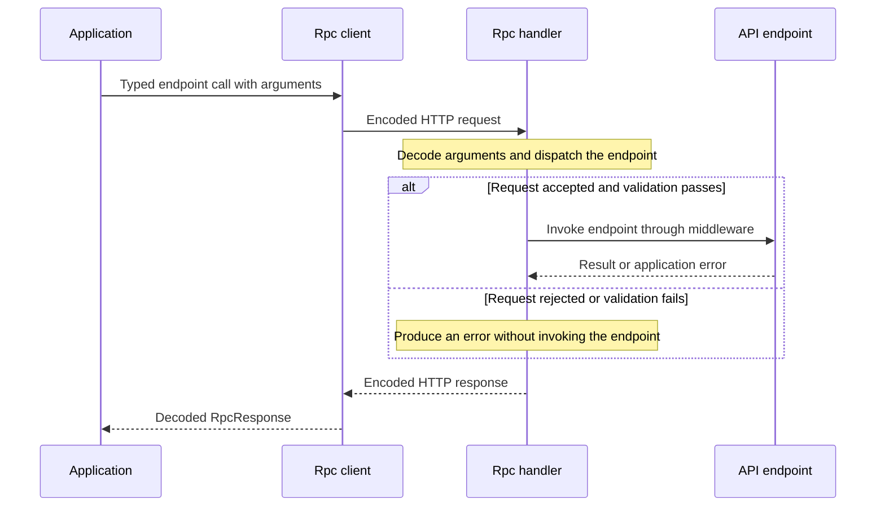

# Communication Protocol

Rpc uses **MessagePack** as its primary communication protocol for efficiency and performance. For clients that do not support MessagePack, it can fall back to **JSON**.

- **`$command`**: Sends data in the request body, encoded with MessagePack (`application/msgpack`). Plain JSON (`application/json`) is also accepted by the server.
- **`$query`**: Sends data in the URL's query string, encoded with MessagePack and Base64. This is the recommended method for cacheable queries.
- **`$get`**: Sends data as plain text in the URL's query string. Useful for clients that do not support MessagePack, or for simple non-complex queries.

The server automatically detects the client's `Accept` header and responds with either MessagePack or JSON.

The endpoint kind determines where and how arguments are carried. Structured query arguments use the MessagePack-and-Base64 representation, whereas plain GET arguments remain text in the URL. Commands use a body; file uploads use multipart encoding instead of the normal MessagePack body. This is why the client's call method must match the server definition.

## Request and response lifecycle

Middleware may also return early without invoking the endpoint. A network failure has no server response and is reported by the client as `NETWORK_ERROR`.

> [!note] Request encoding and response encoding are separate
> The request's `Content-Type` describes its body. The `Accept` header selects the response format; use `Accept: application/json` when you need a JSON response.

When debugging or writing another HTTP client, consider request decoding and response negotiation separately. Sending a JSON command body requires the matching `Content-Type`; requesting a JSON response requires `Accept: application/json`. One header does not stand in for the other, and a JSON response preference does not change how query arguments are encoded in the URL.

The HTTP response status and the decoded RPC result also answer different questions. A successful HTTP exchange can carry an application error, so consumers must interpret the RPC error payload as well as the status code. The typed client wraps that distinction in `RpcResponse`; a custom client needs to account for it explicitly.

## Response Headers

Every response includes the following headers:

| Header                       | Description                                 |
|------------------------------|---------------------------------------------|
| `x-atom-forge-rpc-exec-time` | Server-side execution time in milliseconds. |
