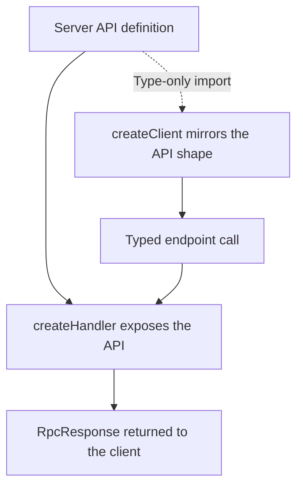

# Getting Started with @atom-forge/rpc

## Installation

```bash
npm install @atom-forge/rpc
pnpm add @atom-forge/rpc
yarn add @atom-forge/rpc
bun add @atom-forge/rpc
```

Choose the installation command for the package manager your project already uses; these are alternatives, not four required steps. The examples below separate the server definition, HTTP handler, and client setup so that each part can fit into your application's existing structure.

## Core Concept: End-to-End Type Safety

Rpc's main feature is providing end-to-end type safety between your server and client. You define your API on the server, then share the type of that definition with the client. This gives you autocompletion and type checking for your API calls.



The dotted arrow represents compile-time type sharing; the other arrows show runtime setup and communication.

> [!warning] Share types, not server implementations
> Use `import type` for the server API on the client. TypeScript checks your calls at compile time, but does not validate incoming HTTP requests. Use Zod schemas for untrusted inputs.

A type-only import is erased from the emitted JavaScript. It lets the client describe the server API without executing the module that implements it. This is particularly important when that module uses database connections or other server-only dependencies. It does not make requests trustworthy: runtime validation remains the server's responsibility, even when your own client is fully typed.

**1. Define your API on the server:**

```typescript
// api.ts (shared API definition)
import {rpc} from '@atom-forge/rpc';

export const api = {
	posts: {
		list: rpc.query(async ({page}: { page: number }, ctx) => {
			// ... fetch posts
			return {posts: [{id: 1, title: 'Hello'}]};
		}),
		create: rpc.command(async ({title}: { title: string }) => {
			// ... create post
			return {success: true};
		}),
	},
};
```

```typescript
// SvelteKit: src/routes/rpc/[...path]/+server.ts
import {createHandler} from '@atom-forge/rpc';
import {api} from '$lib/api';

const rpc = createHandler(api, '/rpc');
export const GET = ({request}) => rpc.handle(request);
export const POST = GET;
```

The API object describes the endpoints, but does not mount an HTTP route by itself. The SvelteKit example connects incoming requests to `createHandler`; other frameworks provide the same bridge in a different form. Keep `/rpc` consistent between the route, the handler, and the client so that calls reach the intended API.

**2. Use the type on the client:**

```typescript
// src/lib/client/rpc.ts
import {createClient} from '@atom-forge/rpc';
import type {api} from '$lib/api';

const [client, cfg] = createClient<typeof api>('/rpc');

// Every call returns a RpcResponse
const res = await client.posts.list.$query({page: 1});
if (res.isOK()) {
	console.log(res.result); // typed as { posts: { id: number, title: string }[] }
}

await client.posts.create.$command({title: 'My New Post'});

export default client;
```

Notice that awaiting a call yields a response wrapper, not just the endpoint's return value. The `isOK()` check both establishes application success and narrows the result type. The final command shows the call syntax, but real application code should also inspect its response before reporting that the post was created.
